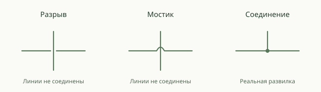

# Аудит раскладки и пересечений — 26 октября 2026 года

Проверена версия `7628726a`, совпадающая с локальным `main` после `git fetch`.
Код приложения не менялся. На production выполнено только чтение в короткой
транзакции `REPEATABLE READ READ ONLY` с ограничением времени запроса.

## Итог

Раскладка сохраняет поколения и размеры карточек; на проверенном снимке нет
наложений карточек и проходов основных линий через карточки. Однако нынешний
поиск оставляет устранимые пересечения. Отдельно подтверждены неполная обработка
перекрёстков, слабая видимость разрывов при уменьшении и ограничение обзора на
узком экране. Пересечения сами по себе не доказывают ошибку семейных данных.

Визуальное обозначение чужого пересечения нужно. Оно уже частично реализовано:
`route-crossings.ts` вставляет разрывы, а адаптер передаёт полученный путь в SVG,
Canvas и WebGL. Утверждение «обозначения пересечений вообще нет» неверно.

## Что и как проверено

- Свежий согласованный снимок основного архива: revision **1260**, **224 человека**,
  **287 родительских связей**, **68 супружеских связей**, **4 дополнительных связи**.
- В диагностическую копию взяты только необходимые поля графа. Идентификаторы
  сохранены: их замена меняет детерминированные сортировки и способна изменить
  результат раскладки. Имена и оригиналы фотографий не копировались.
- Портретные карточки **220 × 264**, полное обычное 2D-древо без фильтра и опорного
  человека. Оба направления поколений посчитаны отдельно.
- Для визуальной проверки использована изолированная локальная SQLite-копия:
  подписи заменены тестовыми, но граф, ID и даты для алгоритма сохранены.
  Проверены desktop 1440 × 1000 и эмулированный мобильный viewport 390 × 844,
  масштаб обзора, 55% и около 95% на desktop. Физический телефон и touch-жесты
  в этом аудите не проверялись.
- **53 существующих теста** в шести файлах прошли: crossing paths, адаптер рёбер,
  порядок семей, сдвиги ветвей, объединение семейных линий и несколько партнёров.
  Отдельные диагностические примеры проверили плотные перекрёстки и Т-касание.
- Механический Impeccable detector для `relationship-edge.tsx` и `tree-canvas.tsx`
  вернул `[]`. Это не проверка геометрической оптимальности и не сертификат WCAG.

Сырые снимки, геометрия и диагностические журналы не добавлены в git.

## Измерено на основном графе

| Показатель | Текущий холодный расчёт | Диагностический альтернативный расчёт |
| --- | ---: | ---: |
| Карточки | 224 | 224 |
| Поколения | 15 | 15 |
| Пересечения по метрике проекта | 5 | 3 |
| Контакты чужих семейных линий | 5 | 3 |
| Наложения карточек | 0 | 0 |
| Проходы линий через карточки | 0 | 0 |
| Суммарная длина основных линий | 133 166 | 123 400 |
| Повороты | 216 | 222 |

Альтернатива получена смещением перебираемых `elk.randomSeed` на 2, без изменения
модели, размеров карточек и ограничений поколений. Проверены одинаковые ID всех
карточек и одинаковое поколение каждой карточки. Линии короче примерно на 7,3%,
но поворотов на 6 больше. Это диагностический кандидат с компромиссом, а не
готовая универсальная настройка и не доказательство глобального оптимума.
Другие проверенные смещения давали 7, 7 и 5 пересечений: один seed не выигрывает
на всех вариантах даже этого графа.

Метрика проекта учитывает уникальный конфликт семейных групп в геометрической
точке. Совпадающие участки нескольких ветвей не нужно повторно считать как
независимые пересечения. В текущей геометрии найдено 9 пересекающихся пар
сегментов; существующие разрывы на трёх путях закрывают все эти строгие
перекрёстки. Подтверждённые ниже ошибки разрывов на этом снимке не проявились.

Один холодный Node-запуск занял **5,764 с**, включая **9 вызовов ELK**. Обратное
направление в том же процессе — 4,235 с. Дополнительная существующая оптимизация
заняла 1,438 с и сохранила 5 пересечений, уменьшив длину до 130 658. Это единичные
локальные замеры Node 22.14.0 на Windows, с влиянием прогрева; они не измеряют
браузерный FPS, серверную задержку или гарантированное время у пользователя.

## Проблемы и резервы улучшения

### L26-01. Поиск оставляет устранимые пересечения

Категория: алгоритм / технический долг. Severity: MEDIUM. Priority: P2.
Confidence: HIGH. Сложность: M–L.

Где: `src/domain/union-layout.ts:730`, `src/domain/union-layout.ts:754`,
`src/domain/family-row-order.ts:123`, `src/domain/family-row-order.ts:227`.

Что происходит: проверяется ограниченный набор seed и локальных перестановок.
Многоуровневые сдвиги уже существуют, но включаются только при `rowUnchanged`:
успешная перестановка одного ряда может исключить этот следующий класс ходов,
хотя пересечения ещё остались. Локальные кандидаты принимаются только без
ухудшения метрик; комбинированный ход с временно худшим промежуточным состоянием
таким поиском не находится. Это ограничения эвристики, не повреждение данных.

Последствие: корректное древо может выглядеть более переплетённым, чем другой
допустимый вариант. Эксперимент 5 → 3 подтверждает резерв на свежем основном
архиве. Каким конкретно локальным ходом убрать оставшиеся 3, не установлено.

Как исправлять: улучшать существующий выбор кандидатов по метрикам, а не
фиксировать seed под один архив. Рассматривать многоуровневый проход после
успешного однорядного, если остались конфликты и есть бюджет. Проверить
ограниченный поиск комбинаций двух ходов с оценкой итоговой геометрии. Сохранять
состав семей, поколения, отсутствие попаданий в карточки и межсемейные интервалы.
Сравнивать качество и время на разных графах, холодном расчёте и правках.
Общую ширину полотна не делать самостоятельной целью.
При изменении детерминированной геометрии обновить версию существующего кеша
в `components/tree/layout-cache.ts` и проверить совместимость сохранённых раскладок.

### L26-02. Некоторые чужие пересечения остаются визуально соединёнными

Категория: корректность визуализации. Severity: MEDIUM. Priority: P1.
Confidence: HIGH. Сложность: S–M.

Где: `src/domain/route-crossings.ts:98`, `src/domain/route-crossings.ts:108`,
`src/domain/route-crossings.ts:138`.

Воспроизведение:

1. Горизонтальная линия `(0,50) → (100,50)`, две чужие вертикальные линии
   при `x=50` и `x=58`, обе от `y=0` до `y=100`.
2. Полученный путь: `M 0 50 L 45 50 M 55 50 L 100 50`.
3. Первый перекрёсток разорван; второй при `x=58` остаётся пересечением.
   Проверено на сегментах, полученных существующим `gpuRoute`.

Причина: координаты перекрёстков ближе 12 просто пропускаются, хотя их зоны
разрыва нужно объединять. Дополнительно фильтры исключают первые/последние
9 единиц горизонтального сегмента и концы вертикального. Поэтому чужая линия,
заканчивающаяся в `(50,50)`, создаёт непрерывное Т-касание; пересечение при
`x=8` на двухточечном прямом маршруте тоже не получает разрыва.

Почему важно: чужое Т-касание выглядит как настоящая семейная развилка.
На основном проверенном графе эти три частных случая не встретились, но они
детерминированно воспроизводятся на корректных геометрических примерах.

Как исправлять: хранить и объединять интервалы разрывов, например
`[45,55] ∪ [53,63] = [45,63]`. Отличать реальное соединение от чужого Т-контакта
по топологии и ID, а не только по совпадению координат. Для близости к углу
ограничивать радиус доступным прямым участком либо поправлять маршрут.
Добавить проверки близких пересечений, обратного направления, Т-касания,
коротких сегментов и настоящих семейных развилок. Общие шины одной семьи
должны сохраняться непрерывными.

### L26-03. Разрывы становятся субпиксельными на обзорном масштабе

Категория: читаемость. Severity: LOW. Priority: P2. Confidence: HIGH.
Сложность: M.

Где: `src/domain/route-crossings.ts:139`,
`src/components/tree/relationship-edge.tsx:76`.

Ширина разрыва всегда 10 единиц геометрии. На desktop при показе всего
проверенного древа zoom был около 0,063945: разрыв занимает **0,64 CSS px**.
На mobile при 5% — **0,5 CSS px**. При 55% это уже 5,5 CSS px, при 95% — 9,5.
В браузере разрывы на рабочих масштабах видны, в обзоре существенно менее ясны.

Это не требование читать все карточки при полном обзоре. Но изменение толщины
линии само по себе не объясняет топологию перекрёстка на малом масштабе.

Как улучшать: рассчитывать точки пересечений один раз, а визуальный радиус
ограничивать с учётом масштаба, соседних углов и доступного места. Не запускать
поиск всех пересечений при каждом кадре зума. На предельно далёком обзоре
использовать упрощение и подсветку выбранной ветви. Не вырезать фиксированные
6 экранных пикселей из любого короткого сегмента: это может стереть его целиком.

### L26-04. Обработка плотных пересечений может дорого повторяться

Категория: производительность, условный риск роста. Severity: MEDIUM.
Priority: P2. Confidence: HIGH для механизма, MEDIUM для его частоты в эксплуатации.
Сложность: M.

Где: `src/domain/route-crossings.ts:32`, `src/domain/route-crossings.ts:94`,
`src/components/tree/tree-edge-adapter.ts:351`.

Вертикальные сегменты отсортированы по X, но для каждого длинного горизонтального
всё равно могут проверяться почти все вертикальные. В худшем случае работа
квадратичная. Большой набор итоговых строк не помещается в лимит кеша 4 МиБ;
кеш правильно защищает память, но такой результат повторно вычисляется при
следующем вызове, даже при неизменной геометрии.

Диагностическая сетка из независимых длинных горизонтальных и вертикальных
маршрутов, один замер на размер:

| Рёбра | Пар перекрёстков | Первый / повторный вызов | Строки путей | Результат сохранён |
| --- | ---: | ---: | ---: | --- |
| 200 | 10 000 | 23 / около 0 мс | 0,44 МБ | да |
| 1000 | 250 000 | 230 / 165 мс | 11,8 МБ | нет |
| 2000 | 1 000 000 | 704 / 605 мс | 51,6 МБ | нет |

Это намеренно тяжёлый синтетический пример, а не измерение обычного древа или
100 одновременно работающих пользователей. На основном архиве подобной
задержки от мостиков не установлено.
Размер строк — расчёт по правилу кеша (два байта на символ), без строки ключа;
это не измерение пикового heap или общей памяти браузера.

Как исправлять при работе с большими проекциями: переиспользовать компактные
метаданные пересечений по ревизии геометрии, ограничивать детальные мостики
читаемым масштабом/видимой областью, вынести тяжёлую подготовку в Worker либо
использовать двумерный индекс/sweep. Не повышать безусловно лимит кеша до
размеров худшего результата и не пересчитывать всё при подсветке одной линии.

### L26-05. Команда полного обзора не вмещает широкое древо на mobile

Категория: камера / UX. Severity: MEDIUM. Priority: P2. Confidence: HIGH.
Сложность: S–M.

Где: `src/components/tree/tree-camera-fit.ts:95`,
`src/components/tree/tree-canvas.tsx:2109`,
`src/components/tree/tree-canvas.tsx:2150`.

После нажатия кнопки с подсказкой «Показать древо целиком» в эмулированном
viewport 390 × 844 установлен zoom 0,05. Фактические экранные границы карточек:
`left ≈ -274`, `right ≈ 664`: сцена шириной **938 px** обрезана по обе стороны
экрана шириной **390 px**. `body.scrollWidth` остаётся 390: это ограничение
камеры, не горизонтальный overflow страницы.

Причина: и расчёт fit, и React Flow ограничены `minZoom=0.05`; требуемый масштаб
для этого полного графа меньше. В большом desktop viewport ограничение
не мешает вместить весь граф.

Как исправлять: для осознанной команды полного обзора допускать рассчитанный
масштаб ниже 5%, согласовав ограничение камеры и уровень детализации. Возврат
к человеку оставлять на читаемом масштабе. Альтернатива — честно предлагать
обзор фрагмента с явным продолжением ветвей, но не обещать показ всего графа,
если он фактически обрезается. Проверить resize, оба направления, фрагменты
и переход из обзора к выбранному человеку.

## Стоит ли рисовать визуальный обход

Да. На оставшихся пересечениях можно показать небольшой мостик-дугу на одной
из линий; настоящую семейную развилку обозначать точкой. Разрыв — тоже
корректный и более спокойный вариант, который уже используется в Drevo.
Главное — различать эти два смысла и одинаково показывать их во всех рендерах.

Такие варианты прямо предусмотрены как `JumpGap` / `JumpOver` в
[GoJS](https://gojs.net/latest/learn/links) и как gap/arc в
[yFiles](https://docs.yworks.com/yfiles-html/dguide/bridges-customizations/).
Это примеры приёма, не рекомендация подключать эти библиотеки.

Для Drevo я бы проверил маленькую дугу на основных линиях при читаемом масштабе,
сохранив пунктир дополнительных связей. Правила реализации:

- единая политика, какая линия проходит сверху; не зависеть от случайного порядка DOM;
- не рисовать точку на чужом пересечении и не разрывать настоящую семейную шину;
- строить мостик только в доступном участке, не на подписи, карточке или наконечнике;
- не менять родственные данные, поколения или реальные концы связи;
- сохранить анимацию, область нажатия, подсветку и экспорт;
- не закрашивать пересечение жёстко белым: должны работать обе темы;
- использовать общую геометрию для SVG/Canvas/WebGL/PDF.

Новая библиотека не нужна: `gpu-route.ts` уже поддерживает `M`, `L`, `Q`, а
Canvas/SVG умеют такие кривые. Аппаратный WebGL и PDF на этом конкретном снимке
визуально не проверялись; по коду путь с разрывами уже передаётся обоим.

## Порядок следующих изменений

1. **S–M:** закрыть L26-02: объединение интервалов, классификация Т-касания,
   регрессионные проверки. Это корректность чтения связей.
2. **S–M:** исправить полный обзор на mobile (L26-05).
3. **M–L:** улучшить сравнение кандидатов раскладки (L26-01), сохраняя семьи,
   поколения, интервалы и измеряя цену каждого дополнительного прохода.
4. **M:** согласовать вид мостика и масштаб (L26-03), затем проверить анимацию,
   выделение и экспорт. Сначала уменьшить лишние пересечения, потом обозначать
   оставшиеся; декоративный обход не заменяет маршрутизацию.
5. **M, по нагрузочным данным:** оптимизировать плотные большие проекции (L26-04).

## Подтверждённые решения, которые стоит сохранить

- Семейные блоки, конкретные союзы и общие участки линий учитываются отдельно.
- Перестановки супругов и переносы целых ветвей уже реализованы; добавлять их
  заново не требуется. Поколения не заменяются сортировкой по возрасту.
- Дополнительные связи не определяют размещение основных семей.
- Существуют ограничения качества: карточки, попадания линий, контакты,
  длина и повороты. Уменьшение общей ширины не является универсальной целью.
- Есть локальный пересчёт до 4000 людей, Worker, кеши и сохранение безопасной
  геометрии. При неподдерживаемой структурной правке выше 200 людей возможен
  полный пересчёт без старой геометрии; это ограничение fallback, а не отсутствие
  инкрементальной раскладки вообще.
- Существующие разрывы не меняют сам граф; SVG, Canvas, GPU и векторный PDF
  используют общий подготовленный путь. Пять основных перекрёстков проверенного
  снимка этим механизмом уже покрываются.

Не удалось проверить: текущую персональную раскладку в авторизованной браузерной
сессии пользователя, все комбинации ручных фильтров и истории правок, физический
телефон, 3D, загрузку настоящих портретов и аппаратный WebGL на этом снимке.

## Исправления по результатам аудита

Исходные результаты выше относятся к `7628726a`. В следующем изменении:

- **L26-01:** убран `rowUnchanged` как условие запуска поиска сдвигов ветвей.
  Успешная перестановка ряда больше не исключает ход сразу нескольких поколений;
  прежние бюджеты и ограничения качества сохранены. Новый составной пример
  требует и перестановки ряда, и сдвига ветви: 2 пересечения → 0, в обоих
  направлениях. С возвращённым старым условием оба теста падают: остаётся одно
  пересечение. Это исправление поиска, а не алгоритм глобального оптимума.
  На основном снимке остаются **5 пересечений**, без попаданий в карточки и
  наложений. Эксперименты с seed не включены в изменение. Кеш раскладки — v23.
- **L26-02:** близкие пересечения объединяются в интервалы вместо пропуска
  следующего. Чужие Т-касания и касания у концов получают разрывы. Реальный
  общий узел определяется группой семьи или совпадающим ID конца связи.
  На свободном участке рисуется непрерывная дуга, а нижняя линия разрывается
  в месте пересечения с самой дугой. Если дуга заденет карточку, соседнюю линию
  либо не поместится у поворота, используется прозрачный разрыв. Геометрия
  родственных связей и исходные маршруты не меняются.
- **L26-03:** размер обозначения зависит от дискретного масштаба камеры и
  ограничен сверху; подписки на каждый кадр движения камеры нет. SVG, Canvas,
  WebGL используют один путь с M/L/Q. PDF получает отдельную подготовку при
  zoom=1, независимо от текущего масштаба экрана. Подложка цвета фона не нужна.
  В предельно уменьшенном обзоре обозначения остаются мелкими: читать отдельные
  связи следует при приближении, а не растягивать мостик через соседние карточки.
- **L26-04:** поиск пересечений заменён Y-sweep с деревом активных X, включая
  концевые точки. Неактивные вертикальные пролёты больше не перебираются.
  Дуговая проверка соседних линий ограничена сценами до 2048 пересекающихся пар;
  более плотные сцены получают разрывы. Кеш ограничивает сильные строки 4 MiB
  суммарно; большие результаты сохраняет через WeakRef, пока текущая подготовка
  сцены владеет Map. Удаление неактивной сцены допускает сборку её большого Map.
- **L26-05:** единый минимум камеры больше не обрезает полный обзор на 5%.
  На копии 224 людей, viewport 390×844, полный обзор дал zoom **0,01736**,
  левую границу карточек **32,14 px**, правую **358 px**. Горизонтальной
  прокрутки страницы нет. Переход к конкретному человеку сохраняет свой
  читаемый масштаб. E2E дополнительно проверяет широкий ряд из 48 потомков
  на desktop, mobile и после уменьшения mobile до 320 px.

Контролируемое сравнение старой и новой функции в одном процессе, Windows /
Node 22.14.0, при работающих других тестах (одиночные наблюдения, не SLA):

| Синтетический сценарий | До: холодный / повтор | После: холодный / повтор |
| --- | ---: | ---: |
| 1000 линий, 250 000 пересечений | 435 / 387 мс | 480 / 2 мс |
| 16 000 линий, непересекающиеся Y-пролёты | 1700 / 14 мс | 105 / 21 мс |

Холодный плотный случай не ускорился: каждый реальный перекрёсток всё ещё
нужно обработать. Повторный выбор линии теперь использует тот же большой Map.
Сравнение выполнено до последней защиты дуг от соседних линий; плотная сцена
выше порога дуг, а сцена без пересечений эту проверку не выполняют.

Браузер: **27 passed / 11 штатных пропусков** — PDF, сворачивание, переходы и
полный обзор; отдельно **12 passed / 10 штатных пропусков** — порядок
карточка → линия → карточка и сохранение стрелок при нажатиях мыши.
Проверены основной снимок на desktop при обзоре и 57%, а также полный обзор
390 px. После параллельного запуска один Worker-тест превысил 60 с; повтор
без других тяжёлых проверок дал **9 passed**, включая этот тест за 45 с.
Таймаут и проверки равенства геометрии не ослаблялись.
